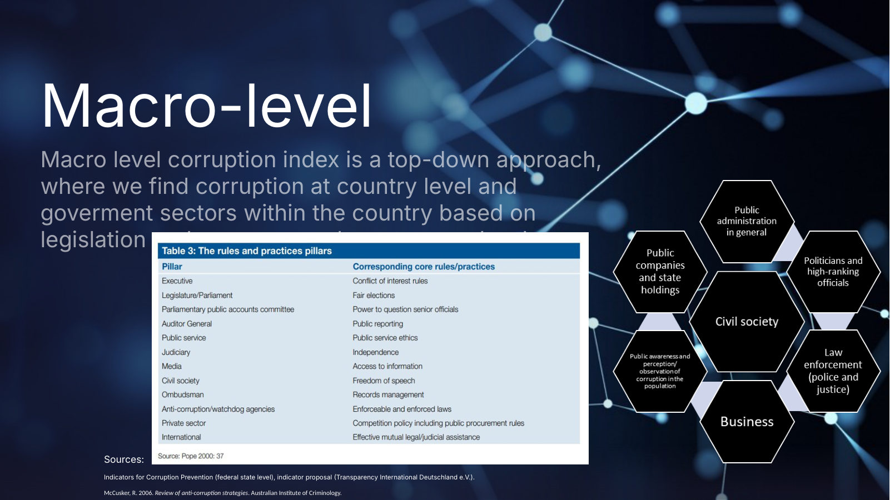
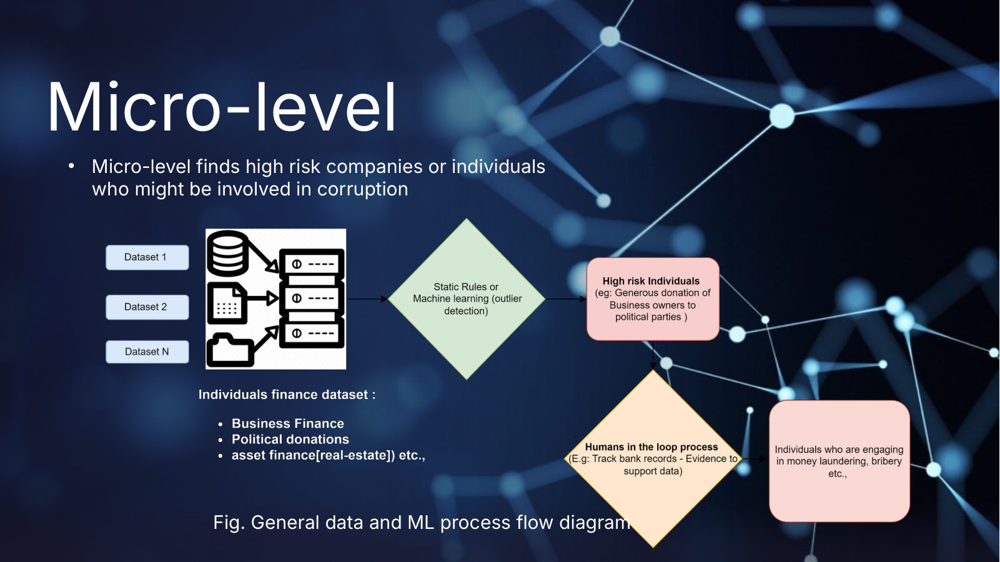
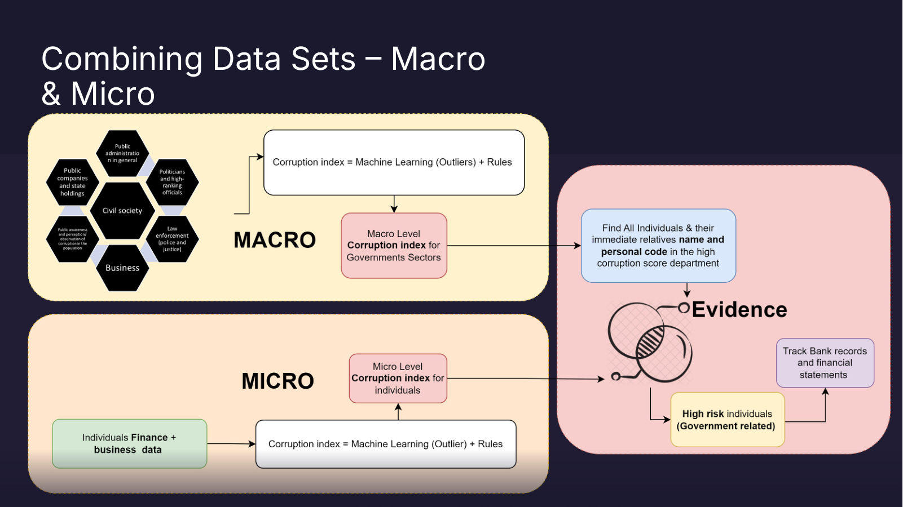
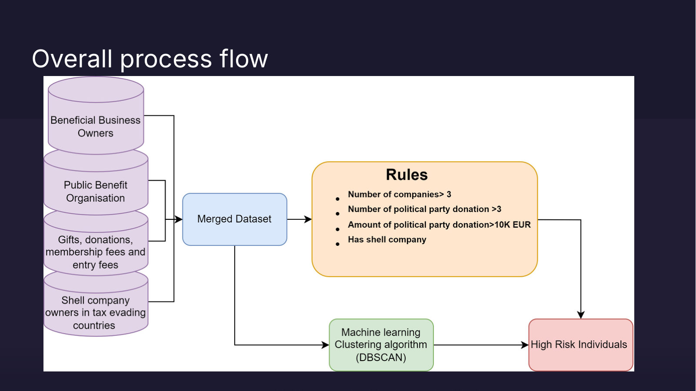

# Following the Money: Latvian Open Data for Anti-Corruption


**Hackathon-winning project** from the Nordic-Baltic Anti-Corruption Open Data Hackathon, held online on January 25-26, 2024.

This project explores how public data can help journalists, civil society, and public institutions spot relationships that may merit further scrutiny. It brings together Latvian political-donation records, beneficial ownership data, public-benefit organization records, and offshore-leak data to explore connections between donors, legal entities, public-benefit organizations, and offshore-leak officers.

The hackathon was organized by Transparency International Latvia (Delna), in cooperation with Transparency International chapters in Estonia and Finland, and funded by the Nordic Council of Ministers. The event invited participants to develop practical ideas for using open data to support transparency and accountable governance. See the [official press release](https://delna.lv/en/2024/01/05/press-release-transparency-international-latvia-invites-to-participate-in-the-anti-corruption-open-data-hackathon/) for details.

## Project overview

The final presentation is in [`CorruptionIndex_AML_overview.pdf`](CorruptionIndex_AML_overview.pdf). It proposes a corruption and anti-money-laundering (AML) risk index that works at two levels.

### Macro level: which government sectors are most exposed



The macro-level index is top-down. It scores the country and its government sectors based on legislation and open data, using the pillars of a national integrity system: the executive, parliament, the judiciary, public administration, public companies and state holdings, law enforcement, business, and civil society.

### Micro level: which individuals and companies merit a closer look



The micro-level index is bottom-up. It combines personal and business finance datasets, such as company ownership and political donations, and applies static rules and machine-learning outlier detection to flag individuals and companies. Anyone flagged then goes to a human-in-the-loop review, for example checking bank records, to collect actual evidence.

### Combining both levels



Each index is calculated as *machine-learning outliers + rules*. Bringing them together narrows the focus to individuals who score high on the micro index **and** work in, or are closely related to people in, a high-scoring government sector. Those cases are then the priority for tracking bank records and financial statements.

### What was built during the hackathon



The demo implements the micro level for Latvia in [`AntiCorruption.ipynb`](AntiCorruption.ipynb). It merges four datasets: beneficial business owners, public-benefit organizations, political donations, and officers in offshore-leak data such as the Pandora Papers. It then screens the merged data in two ways:

- **Rules:** a person owns more than 3 companies, has made more than 3 political-party donations, has donated more than EUR 10,000 in total, or matches an offshore shell-company officer.
- **Clustering:** K-means (and an exploratory DBSCAN run) on the combined features.

**Result:** of roughly 133,000 beneficial owners, K-means clustering on five variables singled out about 100 high-risk individuals for further review.

**Limitations noted in the presentation:** a high index does not necessarily mean corrupt behavior, human analysis is still needed to gather evidence that would hold up in court, and open datasets may be incomplete or manipulated.

**Future applicability:** integrate more open datasets at the micro level, monitor flagged individuals for factual evidence, and use LLMs at the macro level to assess anti-corruption and AML legislation.

## What the analysis explores

The main analysis is in [`AntiCorruption.ipynb`](AntiCorruption.ipynb). It:

- Aggregates beneficial owners by person and links them with political-donation records using normalized names and masked identity numbers.
- Highlights donors who gave to multiple political parties, made large total donations, or own multiple legal entities.
- Cross-references company registration numbers with public-benefit organization records.
- Uses fuzzy name matching to compare Latvian beneficial owners with officers in the included offshore-leak dataset, then exports candidate matches to `ShellOwners.csv`.
- Experiments with K-means and DBSCAN clustering on combined features as an exploratory analysis.

These are investigative leads and exploratory analyses, not findings of corruption or evidence of wrongdoing. In particular, fuzzy name matches can be false positives and must be independently verified.

## Repository contents

| Path | Description |
| --- | --- |
| `AntiCorruption.ipynb` | Main data preparation, joins, screening, and exploratory clustering notebook. |
| `20240125_KNAB_donations.xlsx` | KNAB political-donation records used by the notebook. |
| `beneficial_owners.csv` | Latvian beneficial-ownership register data. |
| `pdb_sloregistrs_odata.csv` | Latvian public-benefit organization register data. |
| `nodes-officers.csv` | Included offshore-leak officer data used for name matching. |
| `ShellOwners.csv` | Export of candidate owner/offshore-leak matches. |
| `violations of procurement procedures/` | Procurement-complaint statistics by period; these files are included as related hackathon data and are not currently loaded by the main notebook. |
| `Local.ipynb`, `Untitled.ipynb` | Additional working notebooks. |
| `CorruptionIndex_AML_overview.pdf` | Final hackathon presentation. |
| `docs/slides/` | Slide images used in this README. |

## Data sources

- Political donations: [KNAB donations database](https://info.knab.gov.lv/lv/db/ziedojumi/). The notebook reads the locally supplied Excel file, described in the notebook as scraped by the Latvia Open Data Team.
- Beneficial ownership: [Latvian open data portal dataset](https://data.gov.lv/dati/eng/dataset/patiesie-labuma-guveji/resource/20a9b26d-d056-4dbb-ae18-9ff23c87bdee).
- Public-benefit organizations: [Latvian open data portal dataset](https://data.gov.lv/dati/eng/dataset/sabiedriska-labuma-organizacijas/resource/476c04af-877c-4136-adc1-a42841650e45).
- Offshore-leak officer records: local `nodes-officers.csv` file, identified in the notebook as aggregated whistleblower leak data.

Register data can change over time. Results may differ if the source data is refreshed or replaced.

## Run the main notebook

Use Python 3 and install the notebook dependencies:

```bash
python -m pip install jupyter pandas numpy openpyxl thefuzz scikit-learn matplotlib
```

Start Jupyter from the repository root so the notebook can find its input files:

```bash
jupyter notebook AntiCorruption.ipynb
```

Run the cells from top to bottom. The notebook reads the four local input files listed above and writes `ShellOwners.csv` in the repository root. The data files are not downloaded automatically.

## Future work

Procurement data is not yet merged into the analysis. The next step is to check whether political donations and public procurement line up: for example, whether donors, or companies they beneficially own, win public contracts from institutions connected to the parties they funded, especially around the time of the donations. Where donations and contract awards line up like this, it would be a strong red flag and a priority for further investigation.

The files in `violations of procurement procedures/` contain only aggregate complaint counts by period and sector, with no supplier identifiers. They cannot be joined to individual donors or companies. This work will need supplier-level contract-award data with company registration numbers, such as the procurement open data published by the Latvian Procurement Monitoring Bureau (IUB). That data could then be linked through `beneficial_owners.csv` to individual donors.

## Limitations and responsible use

- A shared or similar name does not establish that two records refer to the same person. Review candidate matches against reliable identifiers and original records before drawing conclusions.
- Donation thresholds and entity counts are screening choices in the notebook, not legal or ethical judgments.
- The clustering steps are exploratory. They do not determine risk, prove a relationship, or establish misconduct.
- Treat personal and ownership data responsibly, and follow applicable privacy rules when using or sharing derived results.
- Some analysis cells are experimental and may need adjustment for current library versions or refreshed data.

## Hackathon context

The hackathon took place on Zoom from 9:00 to 17:00 on both days and was open to civil society, public institutions, companies, and individuals. It focused on using open data to identify possible corruption risks, conflicts of interest, and opportunities to improve governance. The organizers planned to present the best ideas to the relevant state institutions. Learn more about the [event announcement](https://delna.lv/en/2024/01/05/press-release-transparency-international-latvia-invites-to-participate-in-the-anti-corruption-open-data-hackathon/) and the organizers' [comparative analysis of public data in anti-corruption work](https://delna.lv/en/2023/12/07/the-power-of-public-data-in-fighting-corruption/).
